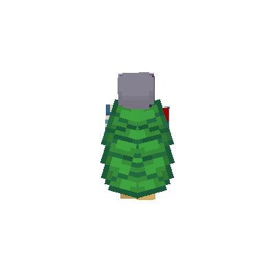

# Library Usage

Eidolon can be used as a Rust library. The package name is `eidolonmc`, and the library crate name is `eidolon`.

## Add Dependency

For local development, use a path dependency:

```toml
[dependencies]
eidolonmc = { path = "../eidolon" }
```

Then import the library crate as `eidolon`.

## Minimal Example

```rust
use eidolon::{
    camera::Camera,
    character::Character,
    renderer::{OutputFormat, Renderer},
};

fn main() -> Result<(), Box<dyn std::error::Error>> {
    let renderer = Renderer::new()?;

    let character = Character::new();                     // classic arms, stand pose
    let skin = renderer.load_texture("skin.png")?;        // auto-converts single→double layer
    let camera = Camera::new();                           // yaw=180, pitch=90, scale=1.0

    renderer.render_to_image(
        &character,
        &skin,
        &camera,
        "output.png",
        (800, 600),
        OutputFormat::Png,
    )?;

    Ok(())
}
```

Key points:
- `Character` no longer holds the skin texture. Pass `&Texture` to render methods — the compiler guarantees it's loaded before rendering.
- `Camera::new()` defaults: yaw 180° (front view), pitch 90° (level), scale 1.0.
- Single-layer skins are expanded to double-layer automatically when loaded.
- `OutputFormat` supports `Png` and `WebP`. Format is inferred from the filename extension by `render_to_image`.

## Error Handling

The public API returns `EidolonError`, a typed enum:

```rust
use eidolon::error::EidolonError;

match renderer.load_texture("skin.png") {
    Ok(skin) => { /* ... */ }
    Err(EidolonError::Io(e)) => eprintln!("File error: {e}"),
    Err(EidolonError::Texture(msg)) => eprintln!("Texture error: {msg}"),
    Err(e) => eprintln!("Other error: {e}"),
}
```

Variants: `Io`, `Gpu`, `Model`, `Texture`, `Conversion`, `InvalidPath`. The `Io` variant wraps `std::io::Error` and exposes it via `Error::source()`.

## Custom Pose Example

```rust
use eidolon::{
    camera::Camera,
    character::{Character, DefaultPostures, SkinType, Posture},
    renderer::{OutputFormat, Renderer},
};

fn main() -> Result<(), Box<dyn std::error::Error>> {
    let mut renderer = Renderer::new()?;

    let mut character = Character::new();
    character.skin_type = SkinType::Slim;
    character.nametag = Some("Steve".to_owned());
    character.nametag_see_through = false; // optional: fully hide occluded pixels
    character.posture = DefaultPostures::WAVE;
    character.rotation.y = 20.0;    // 20° around Y axis
    character.cape = true;
    character.cape_pitch = 10.8;    // degrees around the top-back attachment edge
    renderer.load_cape_texture("cape.png")?;

    let skin = renderer.load_texture("skin.png")?;

    let camera = Camera {
        yaw: 210.0,
        pitch: 90.0,
        scale: 1.2,
    };

    renderer.render_to_image(
        &character,
        &skin,
        &camera,
        "wave.png",
        (1024, 1024),
        OutputFormat::Png,
    )?;

    Ok(())
}
```

## Custom Posture

Build a `Posture` directly. All angles are degrees, 0° = neutral (no rotation from bind pose):

```rust
let posture = Posture {
    cape_pitch: 10.8,        // recommended cape angle for this posture
    body_pitch: 0.0,         // whole-character pitch around its center
    elytra_pitch: 15.0,      // shared wing pitch
    elytra_yaw: 0.5729578,   // left wing yaw; mirrored on the right
    elytra_roll: 15.0,       // left wing roll; mirrored on the right
    head_yaw: 0.0,           // 0° = facing forward, positive = turn right
    head_pitch: 0.0,         // 0° = level, positive = look up
    left_arm_roll: 0.0,      // 0° = neutral
    left_arm_pitch: 0.0,     // 0° = arm down, negative = swing forward
    right_arm_roll: 0.0,
    right_arm_pitch: 0.0,
    left_leg_pitch: 0.0,     // 0° = straight down
    right_leg_pitch: 0.0,
};
```

Presets are available via `DefaultPostures`:

| Constant | Description |
|----------|-------------|
| `DefaultPostures::STAND` | Neutral standing pose; cape 10.8° |
| `DefaultPostures::WAVE` | Left arm raised in a wave; cape 10.8° |
| `DefaultPostures::WALKING` | Arms and legs in walking swing; cape baseline 10.8° |
| `DefaultPostures::RUNNING` | Arms and legs in running swing; cape baseline 54° |
| `DefaultPostures::FLYING` | Horizontal player with neutral limbs, 20° pitch, and 60° elytra spread |

## Skin Conversion

Convert legacy single-layer skins to double-layer without rendering:

```rust
use eidolon::converter;

let img = image::open("old_skin.png")?;
let double_layer = converter::single2double(&img)?;
double_layer.save("new_skin.png")?;
```

The input must have `width == height * 2` (e.g., 64×32). Returns `EidolonError::Conversion` on invalid input.

## Windowed Preview

For interactive preview, use `Renderer::new_windowed` with a `winit` window:

```rust
use std::sync::Arc;
use winit::window::Window;

let window = Arc::new(/* winit Window */);
let renderer = Renderer::new_windowed(window)?;
let skin = renderer.load_texture("skin.png")?;

// In your event loop:
renderer.render_frame(&character, &skin, &camera)?;
```

## Notes

- `Renderer::new()` and `Renderer::new_windowed()` load both bundled OBJ models from `resources/`, so run from the repository root or keep those resource paths available.
- `Model::load_from_obj_bytes()` is available for loading OBJ data from memory.
- `Camera::scale` (renamed `cam_zoom` in the CLI) controls orbit distance: `distance = 4.0 / scale`. Larger values move the camera closer.
- Character rotation is Euler: X first, then Y, then Z.
- Set `Character::nametag` to `Some(name)` to draw an unlit, camera-facing label above the player.
  The label uses the bundled Monocraft pixel font, a white glyph shadow, a translucent black
  background, and scene depth testing. Nametags are single-line and limited to 64 characters;
  characters missing from the bundled font use its standard missing-glyph box.
- Nametag spacing is applied along the scene's vertical Y axis after finding the highest point of
  the transformed player collision box's scene-space AABB. The label is centered over that AABB.
  The collision box is 1.8 world units tall and the default gap is 0.5 units; both scale with
  `Camera::scale`.
  Occluded pixels render at 25% opacity by default, followed by the normal depth-tested pass. Set
  `Character::nametag_see_through` to `false` to hide occluded pixels completely.
- Call `Renderer::load_cape_texture()` and set `Character::cape` to render a cape; there is no
  built-in default texture. `Character::cape_pitch` rotates it around the top-back shoulder
  attachment edge; the skinview3d-compatible default is `10.8` degrees.
- Call `Renderer::load_elytra_texture()` and set `Character::elytra` to render elytra. Elytra use
  the same 2:1 cape atlas format (64x32 or an HD multiple). Postures control both wings through
  `elytra_pitch`, `elytra_yaw`, and `elytra_roll`; both wings rotate around the central upper-back
  attachment, and the right wing mirrors the left wing's yaw and roll. `DefaultPostures::FLYING`
  uses `20°` pitch and a `60°` spread; applications can construct other
  snapshots with the same fields. Applications should enable either cape or elytra, not both.


