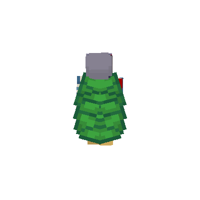

# 作为库使用

Eidolon 可以作为 Rust 库使用。核心渲染引擎由 `eidolon-core` 提供（库 crate 名为 `eidolon_core`）。

## 添加依赖

本地开发或在 Monorepo 内使用 path 依赖：

```toml
[dependencies]
eidolon_core = { path = "crates/core" }
```

或别名为 `eidolon`：

```toml
[dependencies]
eidolon = { package = "eidolon-core", path = "crates/core" }
```

然后以 `eidolon`（或 `eidolon_core`）引入库。

## 最小示例

```rust
use eidolon::{
    camera::Camera,
    character::{Character, SkinType},
    output::{write_output, OutputIntent, StaticFormat},
    renderer::Renderer,
};
use std::time::Duration;

fn main() -> Result<(), Box<dyn std::error::Error>> {
    let renderer = Renderer::new()?;

    let body = renderer.load_body("resources/bingling_sama.png", SkinType::Classic)?;
    let character = Character::from_body(body);           // 默认站立姿势
    let camera = Camera::new();                            // yaw=180, pitch=90, scale=1.0, target=[0.0, 1.0, 0.0]

    write_output(
        "output.png",
        OutputIntent::Static {
            format: StaticFormat::Png,
            size: (800, 600),
        },
        |_: Duration| renderer.render(&character, &camera, 800, 600),
    )?;

    Ok(())
}
```

核心要点：
- `Character` 持有角色自己的可视资源，并且必须至少包含 `Body` 或后背装备。
- `Body` 将 Skin 与 `SkinType` 组合在一起；单层 Skin 在加载时会自动转换为双层。
- 克隆 `Character`、`Body` 或 `BackEquipmentAtlas` 会共享不可变 GPU 资源。这些资源只能由创建它们的 `Renderer` 渲染；另一个 Renderer 必须重新加载资源。
- `Camera::new()` 默认值：yaw 180°（正视图），pitch 90°（水平），scale 1.0，target `[0.0, 1.0, 0.0]`。
- `StaticFormat` 支持 `Png` 与 `WebP`。`OutputIntent` 显式指定格式，输出模块会统一扩展名并返回最终路径。
- `AnimationFormat` 支持 `Gif`、Animated `WebP`、`Apng` 与 `Avif`。`OutputIntent::Animation` 接受 `AnimationPreset`、FPS、速度倍率、循环次数和 frame producer，并返回最终路径。

## 错误处理

公共 API 返回强类型枚举 `EidolonError`：

```rust
use eidolon::{character::SkinType, error::EidolonError};

match renderer.load_body("skin.png", SkinType::Classic) {
    Ok(body) => { /* ... */ }
    Err(EidolonError::Io(e)) => eprintln!("文件错误: {e}"),
    Err(EidolonError::Texture(msg)) => eprintln!("纹理错误: {msg}"),
    Err(e) => eprintln!("其他错误: {e}"),
}
```

枚举变体包括：`Io`、`Gpu`、`Model`、`Texture`、`Conversion`、`InvalidPath`、`Output` 和 `Surface`。`Io` 包装 `std::io::Error`；`Output` 覆盖输出校验、编码与写入失败；`Surface` 保留 `wgpu::SurfaceError`，便于窗口事件循环从 `Lost` 恢复并在 `OutOfMemory` 时退出。

## 自定义姿势示例

```rust
use eidolon::{
    back_equipment::{BackEquipment, BackEquipmentKind},
    camera::Camera,
    character::{Character, DefaultPostures, SkinType},
    output::{write_output, OutputIntent, StaticFormat},
    renderer::Renderer,
};
use std::time::Duration;

fn main() -> Result<(), Box<dyn std::error::Error>> {
    let renderer = Renderer::new()?;
    let body = renderer.load_body("resources/bingling_sama.png", SkinType::Slim)?;
    let atlas = renderer.load_back_equipment_atlas("cape.png")?;
    let mut character = Character::from_body(body);
    character.nametag = Some("Steve".to_owned());
    character.nametag_see_through = false; // 可选：完全隐藏被遮挡的部分
    character.posture = DefaultPostures::WAVE;
    character.rotation.y = 20.0;    // 绕 Y 轴旋转 20°
    character.posture.cape_pitch = 10.8;
    character.equip(BackEquipment::new(atlas, BackEquipmentKind::Cape));

    let camera = Camera {
        yaw: 210.0,
        pitch: 90.0,
        scale: 1.2,
        target: [0.0, 1.0, 0.0],
    };

    write_output(
        "wave.png",
        OutputIntent::Static {
            format: StaticFormat::Png,
            size: (1024, 1024),
        },
        |_: Duration| renderer.render(&character, &camera, 1024, 1024),
    )?;

    Ok(())
}
```

## 多角色场景

使用 `Scene` 在同一个共享 3D 场景与单次渲染 pass 中管理和渲染多个角色：

```rust
use cgmath::Vector3;
use eidolon::{
    camera::Camera,
    character::{Character, DefaultPostures, SkinType},
    output::{write_output, OutputIntent, StaticFormat},
    renderer::Renderer,
    scene::Scene,
};
use std::time::Duration;

fn main() -> Result<(), Box<dyn std::error::Error>> {
    let renderer = Renderer::new()?;

    let mut scene = Scene::new(Camera {
        yaw: 200.0,
        pitch: 80.0,
        scale: 1.2,
        target: [0.0, 1.0, 0.0],
    });

    let steve_body = renderer.load_body("steve.png", SkinType::Classic)?;
    let mut steve = Character::from_body(steve_body);
    steve.position = Vector3::new(-1.2, 0.0, 0.0);
    steve.nametag = Some("Steve".to_owned());
    scene.add_character(steve);

    let alex_body = renderer.load_body("alex.png", SkinType::Slim)?;
    let mut alex = Character::from_body(alex_body);
    alex.position = Vector3::new(1.2, 0.0, 0.0);
    alex.posture = DefaultPostures::WAVE;
    alex.nametag = Some("Alex".to_owned());
    scene.add_character(alex);

    write_output(
        "scene.png",
        OutputIntent::Static {
            format: StaticFormat::Png,
            size: (1280, 720),
        },
        |_: Duration| renderer.render_scene(&scene, 1280, 720),
    )?;

    Ok(())
}
```

多角色功能特性：
- `Scene::new(camera)` 创建带独立相机的多角色容器。
- `scene.add_character(character)` 添加角色实体。角色通过 `character.position` 和 `character.rotation`（`cgmath::Vector3<f32>`）在世界空间中定位与旋转。
- `scene.compute_bounds()` 计算所有角色在场景空间的合并 AABB 包围盒。
- `scene.auto_frame_camera()` 自动调整相机位置与缩放比例，使所有角色完整容纳在视口中。
- `renderer.render_scene(&scene, width, height)` 在单个渲染 pass 中分 3 个阶段渲染所有角色（阶段 1：角色身体与分层；阶段 2：被遮挡的半透明名字标签；阶段 3：正面名字标签），并使用动态 uniform chunking 批量高效渲染。

## 自定义姿势构造

可以直接构造 `Posture`。所有角度均为角度制（度），0° 代表中立位（无旋转）：

```rust
let posture = Posture {
    cape_pitch: 10.8,        // 当前姿势推荐的披风角度
    body_pitch: 0.0,         // 整个角色绕中心俯仰
    elytra_pitch: 15.0,      // 鞘翅统一俯仰
    elytra_yaw: 0.5729578,   // 左侧偏航；右侧自动镜像
    elytra_roll: 15.0,       // 左侧翻滚；右侧自动镜像
    head_yaw: 0.0,           // 0° = 正视前方，正值向右转
    head_pitch: 0.0,         // 0° = 水平，正值向上看
    left_arm_roll: 0.0,      // 0° = 中立
    left_arm_pitch: 0.0,     // 0° = 下垂，负值向前摆
    right_arm_roll: 0.0,
    right_arm_pitch: 0.0,
    left_leg_pitch: 0.0,     // 0° = 垂直向下
    right_leg_pitch: 0.0,
};
```

预设姿势可通过 `DefaultPostures` 访问：

| 常量 | 描述 |
|------|------|
| `DefaultPostures::STAND` | 中立站立姿势；披风 10.8° |
| `DefaultPostures::WAVE` | 左臂举起挥手；披风 10.8° |
| `DefaultPostures::WALKING` | 四肢行走摆动；披风基线 10.8° |
| `DefaultPostures::RUNNING` | 四肢奔跑摆动；披风基线 54° |
| `DefaultPostures::FLYING` | 角色水平飞行动作，四肢中立，20° 俯仰，60° 鞘翅开合 |

## 程序化动画

`AnimationPreset` 保持为无状态采样基础：调用方传入时间，得到完整 `Posture`。
`AnimationTimeline` 提供跨平台播放状态，`AnimationSchedule` 为离线输出提供确定性采样时刻。

```rust
use eidolon::animation::AnimationPreset;
use std::time::Duration;

let animation = AnimationPreset::Walk;
character.posture = animation.sample(Duration::from_millis(250));
assert_eq!(
    animation.sample(Duration::ZERO),
    animation.sample(animation.cycle_duration()),
);
```

内置动作包括 `Idle`（4 秒）、`Walk`（1 秒）、`Run`（0.6 秒）、`Wave`（1.2 秒）和
`Fly`（1.5 秒）。adapter 向 timeline 提供帧间隔，因此 native `Instant` 与浏览器动画时间戳
仍留在各自 adapter。timeline 负责速度、播放/暂停、seek、循环/结束，并忽略超过 250ms 的帧间隔。
每次 Renderer 调用前使用 `timeline.sample()` 更新 `Character::posture`。

## 皮肤转换

无需初始化渲染器即可将旧版单层皮肤转换为双层皮肤：

```rust
use eidolon::converter;

let img = image::open("old_skin.png")?;
let double_layer = converter::single2double(&img)?;
double_layer.save("new_skin.png")?;
```

输入图像必须满足 `width == height * 2`（如 64×32）。输入不合法时返回 `EidolonError::Conversion`。

## 纹理检测与分类

从图片字节自动识别并分类 Minecraft 皮肤、披风或鞘翅纹理：

```rust
use eidolon::classifier::{inspect_texture, TextureKind};

let bytes = std::fs::read("skin.png")?;
let report = inspect_texture(&bytes)?;

println!("检测类型: {}", report.kind.as_str());
println!("尺寸: {}x{}", report.width, report.height);
println!("高清倍率: {}x (is_hd={})", report.hd_scale, report.is_hd);
println!("是否支持自动升级为双层: {}", report.can_auto_upgrade);
```

支持类型包括 `SkinDoubleLayer`、`SkinSingleLayer`、`Cape`、`Elytra`、`CapeAndElytra` 及 `Unknown`。

## 窗口预览

交互式预览使用 `Renderer::new_windowed` 配合 `winit` 窗口：

```rust
use std::sync::Arc;
use winit::window::Window;

let window = Arc::new(/* winit Window */);
let renderer = Renderer::new_windowed(window)?;
let body = renderer.load_body("skin.png", SkinType::Classic)?;
let character = Character::from_body(body);

// 在事件循环中：
renderer.render_frame(&character, &camera)?;
```

用 `with_transparent(true)` 创建的窗口依然通过 HWND 交换链呈现，在 Windows 上会忽略逐像素 alpha。若要在 Windows 上得到透明背景，需要创建不带重定向表面的窗口，并让渲染器呈现到 DirectComposition visual：

```rust
#[cfg(windows)]
let renderer = unsafe { Renderer::new_windowed_composition(visual_ptr, width, height)? };
```

`visual_ptr` 是 `IDCompositionVisual` 背后的裸 `*mut c_void`，生命周期必须长于渲染器。该构造函数强制使用 DX12 后端，它是唯一能呈现到 composition visual 的后端。

## 说明

- `Renderer::new()` 和 `Renderer::new_windowed()` 会从 `resources/` 加载两套内置 OBJ 模型，因此建议从仓库根目录运行，或确保这些资源路径可用。
- `Model::load_from_obj_bytes()` 可用于从内存加载 OBJ 数据。
- `Camera::scale`（CLI 里是 `cam_zoom`）以镜头变焦实现放大：相机轨道半径固定，视场角随 `scale` 增大而变窄。
- `Camera::target` 设置世界空间注视点（默认 `[0.0, 1.0, 0.0]` 对准躯干中心）。在交互式预览中，平移视角会在相机视图平面平行移动 `target`。
- 角色旋转顺序为欧拉角：先 X，后 Y，最后 Z。
- 将 `Character::nametag` 设为 `Some(name)` 可在玩家头顶显示始终朝向相机的标签。标签使用内置 Minecraft 像素字体与 Unifont 回退字体、白字深色阴影、半透明黑底和场景深度测试；仅支持单行，最多渲染 64 个字符；字体不包含的字形会显示字体自身的缺字方框。
- 标签先变换玩家碰撞箱并计算场景空间 AABB，定位在 AABB 水平中心的最高点上方，再沿场景垂直 Y 轴增加间距。碰撞箱高度为 1.8 个世界单位，默认间距为 0.5 个单位。被遮挡的像素默认以 25% 透明度绘制，然后叠加正常深度测试层；将 `Character::nametag_see_through` 设为 `false` 可完全隐藏被遮挡的像素。
- 使用 `Renderer::load_back_equipment_atlas()` 加载披风与鞘翅共享的 2:1 图集，再用 `BackEquipment::new(atlas, BackEquipmentKind::Cape)` 或 `BackEquipmentKind::Elytra` 选择呈现形式。修改 `BackEquipment::kind` 不需要重新加载图集。
- Character 可以只有后背装备而没有 Body，因此披风和鞘翅都可以在玩家坐标系中独立渲染。`Posture::cape_pitch` 控制披风绕肩部背面顶边旋转，与 skinview3d 一致的默认值为 `10.8` 度。
- 鞘翅使用同一图集，姿势中的 `elytra_pitch`、`elytra_yaw`、`elytra_roll` 控制左侧鞘翅；左右两片绕中央上背连接点旋转，右侧会镜像 yaw 和 roll；`DefaultPostures::FLYING` 会将玩家整体转至水平，并使用 `20°` 俯仰和 `60°` 开合角。应用可以用相同字段构造其它开合快照。`BackEquipmentKind` 保证一次只选择一种呈现形式。


