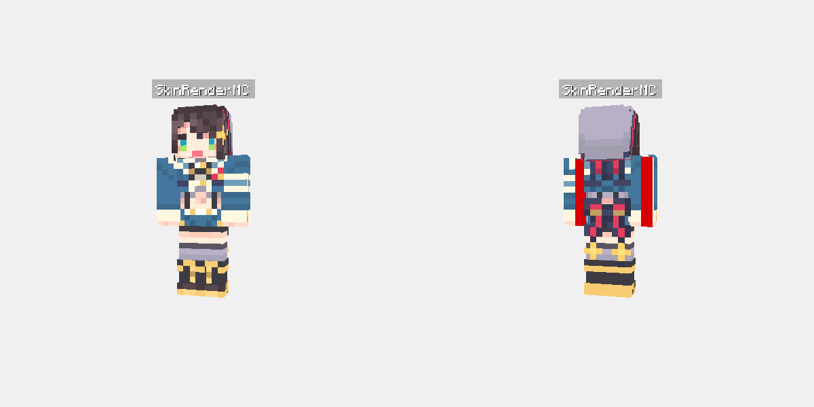

# Eidolon HTTP Rendering Server

A resident high-performance HTTP microservice for offscreen Minecraft skin rendering.

## Advantages

- **Zero GPU Cold Start**: `Renderer`, WGPU context, shaders, and OBJ models remain resident in memory. Per-request latency drops from ~400ms down to ~10–25ms.
- **Concurrent Worker Pool**: Render tasks are dispatched to dedicated worker threads with queue buffering and backpressure.
- **In-Memory Image Caching**: Network-fetched skins/capes (e.g. from Mojang CDN) are cached in memory using `moka` LRU cache.
- **Zero Disk Writes**: Rendered frames are encoded directly into memory buffers and streamed to the HTTP response.

## Quick Start

### 1. Docker (Recommended)

```bash
# Start with docker-compose from repository root
docker compose -f examples/server/docker-compose.yml up -d --build

# Or from examples/server directory directly
cd examples/server && docker compose up -d --build

# Or build & run directly with Docker
docker build -f examples/server/Dockerfile -t eidolon-server .
docker run -d --name eidolon-server -p 8080:8080 eidolon-server
```

### 2. Native Cargo Run

```bash
# Set headless rendering environment (if running without physical display/GPU)
export LIBGL_ALWAYS_SOFTWARE=1
export MESA_LOADER_DRIVER_OVERRIDE=llvmpipe

# Run server
cargo run --release -p eidolon-server -- --port 8080 --workers 2
```

## CLI / Environment Options

| Flag | Env Variable | Default | Description |
|---|---|---|---|
| `--host` | `EIDOLON_HOST` | `0.0.0.0` | Bind address |
| `-p, --port` | `EIDOLON_PORT` | `8080` | Port to listen on |
| `-w, --workers` | `EIDOLON_WORKERS` | `2` | Number of dedicated GPU worker threads |
| `--queue-capacity` | `EIDOLON_QUEUE_CAPACITY` | `256` | Maximum pending render queue depth |
| `--cache-entries` | `EIDOLON_CACHE_ENTRIES` | `2048` | Max in-memory texture cache count |
| `--cache-ttl` | `EIDOLON_CACHE_TTL` | `3600` | Texture cache TTL in seconds |

## API Endpoints

### SkinRenderMC Full Compatibility Endpoints

The server provides 1:1 drop-in replacement endpoints matching the [SerinaNya/SkinRenderMC](https://github.com/SerinaNya/SkinRenderMC) API.



*Figure: Dual-view (`both`) rendered output with `#FFFFFF` opaque background (`transparent=false`) and overhead `nametag`.*

#### 1. `GET /`
Returns the SkinRenderMC status payload.
```json
{
  "status": 200,
  "msg": "SkinRenderMC"
}
```

#### 2. `GET /url/image/{view}` and `POST /url/image/{view}`
Renders character images by texture URL for a given view (`front`, `back`, or `both`). POST requests seamlessly accept `application/json`, `application/x-www-form-urlencoded`, or URL query parameters.

- **Path Parameter**: `{view}` - `front`, `back`, or `both`.
- **Dimensions**:
  - `front` / `back`: Strictly derived from `definition`: `350 * definition` × `670 * definition` (e.g. 700x1340 at default definition 2.0).
  - `both`: Strictly derived from `definition`: `700 * definition` × `670 * definition` (e.g. 1400x1340 at default definition 2.0), stitching front (left) and back (right).
- **Query / JSON / Form Parameters**:
  - `skinUrl` (string, required): Direct URL or path to player skin.
  - `capeUrl` (string, optional): Direct URL or path to player cape.
  - `nameTag` or `nametag` (string, optional): Text for player nameplate above head.
  - `definition` (float, optional, default `2.0`): Resolution multiplier in range `0.8..=3.5`.
  - `transparent` (bool, optional, default `true`): If `false`, transparent areas are blended onto `#FFFFFF` opaque background.
  - `slim` (bool, optional): Overrides Alex 3px arm detection.

```bash
# Render both front and back (GET)
curl "http://127.0.0.1:8080/url/image/both?skinUrl=https://textures.minecraft.net/texture/...&nameTag=Steve" -o both.png

# Render both front and back (POST with JSON)
curl -X POST "http://127.0.0.1:8080/url/image/both" \
  -H "Content-Type: application/json" \
  -d '{"skinUrl": "https://textures.minecraft.net/texture/...", "nameTag": "Steve", "definition": 2.0}' \
  -o both.png
```

#### 3. `GET /url/json/all`
Renders `front`, `back`, and `both` views simultaneously and returns them as Base64 strings in a JSON payload. Respects `transparent=false` by compositing on `#FFFFFF`.

- **Output**:
```json
{
  "front_b64": "...",
  "back_b64": "...",
  "both_b64": "...",
  "backendInfo": {
    "slim": false,
    "serverTimeJs": "Mon Nov 02 2026 15:04:05 GMT+0000 (Coordinated Universal Time)"
  }
}
```

#### 4. `GET /mojang/image/{view}`
Directly queries official Mojang session servers to resolve skin and cape textures and slim model metadata by player username, then renders the requested view (`front`, `back`, or `both`).

- **Query Parameters**:
  - `name` (string, required): Minecraft player username (e.g. `Steve`).
  - Supports all SkinRenderMC options (`definition`, `transparent`, etc.).
- **Default Skin Fallback**: If a player account exists but has never uploaded a custom skin, the service automatically falls back to Mojang's official Steve (classic 4px) or Alex (slim 3px) texture based on the player UUID hash parity.
- **Upstream Error Handling**: Upstream rate limits (HTTP 429) or session server outages (HTTP 5xx) are mapped to HTTP 502 (Bad Gateway) with descriptive error messages instead of false 404 (Not Found).

```bash
curl "http://127.0.0.1:8080/mojang/image/both?name=Steve" -o steve.png
```

#### 5. `GET /littleskin/image/{view}`
Queries LittleSkin Yggdrasil API to resolve player skin, cape textures, and slim model metadata by username, then renders the requested view.

- **Query Parameters**:
  - `name` (string, required): LittleSkin player username.
  - Supports all SkinRenderMC options (`definition`, `transparent`, etc.).
- **Default Skin Fallback & Error Handling**: Same fallback and error handling as Mojang endpoint.

```bash
curl "http://127.0.0.1:8080/littleskin/image/both?name=BinglingTX" -o bingling.png
```

---

### Custom Rendering & Utilities

#### `GET /render` / `POST /render` (Flexible Single View)

#### Parameters

| Parameter | Type | Default | Description |
|---|---|---|---|
| `skinUrl` (or `skin_url`, `skin`) | string | **Required** | URL or local path to player skin PNG |
| `capeUrl` (or `cape_url`, `cape`) | string | `None` | URL or local path to cape PNG |
| `elytraUrl` (or `elytra_url`, `elytra`) | string | `None` | URL or local path to elytra PNG |
| `slim` | bool / string | `false` | Alex slim arm geometry (`true`, `false`, `1`, `0`) |
| `posture` | string | `idle` | `idle`, `walk`, `run`, `wave`, `fly` |
| `width` | u32 | `512` | Image width in pixels |
| `height` | u32 | `512` | Image height in pixels |
| `format` | string | `png` | `png` or `webp` |
| `nametag` | string | `None` | Player nameplate rendered above head |
| `cam_yaw` | f32 | `180.0` | Camera orbit yaw (degrees) |
| `cam_pitch` | f32 | `90.0` | Camera orbit pitch (degrees) |
| `cam_zoom` | f32 | `1.0` | Camera zoom multiplier |

#### Example Request

```bash
curl "http://127.0.0.1:8080/render?skinUrl=https://textures.minecraft.net/texture/xxx&capeUrl=https://textures.minecraft.net/texture/yyy&slim=1&posture=wave" -o player.png
```

#### `POST /scene/render` (Multi-character Scene Rendering)

Renders a 3D scene containing multiple characters specified in JSON. If `camera` is omitted, the camera automatically frames and centers all characters in the scene.

##### Request Body

```json
{
  "width": 800,
  "height": 600,
  "format": "png",
  "transparent": true,
  "camera": {
    "yaw": 180.0,
    "pitch": 90.0,
    "scale": 1.0,
    "target": [0.0, 1.0, 0.0]
  },
  "characters": [
    {
      "skin": "https://textures.minecraft.net/texture/xxx",
      "skin_type": "classic",
      "position": [-0.8, 0.0, 0.0],
      "rotation": [0.0, 15.0, 0.0],
      "posture": "wave",
      "nametag": "Alex"
    },
    {
      "skin": "https://textures.minecraft.net/texture/yyy",
      "cape": "https://textures.minecraft.net/texture/zzz",
      "skin_type": "slim",
      "position": [0.8, 0.0, 0.0],
      "rotation": [0.0, -15.0, 0.0],
      "posture": "walk",
      "nametag": "Steve"
    }
  ]
}
```

- Each character supports: `skin` (or `skinUrl`), `cape` (or `capeUrl`), `elytra` (or `elytraUrl`), `skin_type` (or `slim`), `position` (or `pos_x`, `pos_y`, `pos_z`), `rotation` (or `rot_x`, `rot_y`, `rot_z`), `posture`, `nametag`, and joint angle overrides.
- Returns `image/png` or `image/webp`.

### 2. `GET /health`

Healthcheck endpoint. Returns JSON:

```json
{
  "status": "ok",
  "uptime_secs": 120
}
```

## Operational Considerations & Limitations

- **Upstream Rate Limits**: Unauthenticated profile lookups against Mojang (`api.mojang.com` / `sessionserver.mojang.com`) are throttled by Mojang (~600 requests / 10 minutes per IP). LittleSkin endpoints also apply per-IP rate limits.
- **Texture Caching**: Downloaded texture bytes are cached in an in-memory LRU cache (`--cache-entries`, `--cache-ttl`).
- **Memory Footprint**: `/url/json/all` concurrently renders three separate views and encodes them to base64, which temporarily allocates multiple image buffers. Ensure worker concurrency (`--workers`) matches host memory capacity.

## Testing

Run the server microservice test suite (10 unit and HTTP integration tests):

```bash
cargo test -p eidolon-server
```

The test suite covers:
- Route matching and HTTP status code mappings (`GET /`, `/health`, error handlers)
- POST parameter decoding and Query/Body parameter merging
- Definition resolution scaling calculations (`0.8..=3.5`)
- Opaque `#FFFFFF` background alpha blending
- Mojang/LittleSkin URL percent-encoding (`url_encode`)
- Java-compliant UUID hash parity determination (`default_model_is_alex`) and default Steve/Alex fallback
- Dual-view horizontal stitching and PNG encoding

## Python Integration (`skinrendermcapi.py`)

Replace `subprocess.run(["eidolon", "render", ...])` with a direct HTTP request:

```python
import httpx

def render_skin(skin_url: str, cape_url: str = None, is_slim: bool = False) -> bytes:
    response = httpx.get(
        "http://127.0.0.1:8080/render",
        params={
            "skinUrl": skin_url,
            "capeUrl": cape_url,
            "slim": is_slim,
            "posture": "idle",
            "width": 512,
            "height": 512,
        },
        timeout=10.0,
    )
    response.raise_for_status()
    return response.content
```
