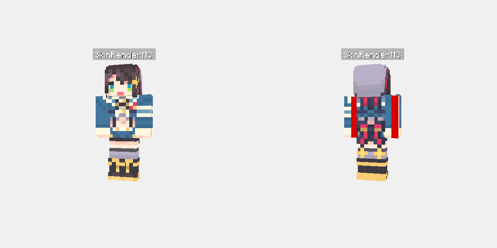

# Eidolon HTTP 皮肤渲染服务器

基于常驻进程的高性能 Minecraft 皮肤离屏渲染 HTTP 微服务。

## 优势

- **零 GPU 冷启动**：`Renderer`、WGPU 上下文、着色器与 OBJ 模型常驻显存。单次请求延迟由 ~400ms 降至 ~10–25ms。
- **并发 Worker 线程池**：渲染任务派发给专有工作线程，支持队列缓冲与背压控制。
- **内存纹理缓存**：从网络下载的皮肤/披风纹理（如 Mojang CDN）采用 `moka` LRU 缓存常驻内存。
- **零磁盘写入**：渲染完成的帧直接编码为内存字节流并作为 HTTP 响应返回。

## 快速上手

### 1. Docker（推荐）

```bash
# 使用 docker-compose 启动
docker compose up -d --build

# 或直接构建运行
docker build -t eidolon-server .
docker run -d --name eidolon-server -p 8080:8080 eidolon-server
```

### 2. 本地原生 Cargo 运行

```bash
# 设置无头渲染环境（若无物理显示器/GPU）
export LIBGL_ALWAYS_SOFTWARE=1
export MESA_LOADER_DRIVER_OVERRIDE=llvmpipe

# 启动服务
cargo run --release -p eidolon-server -- --port 8080 --workers 2
```

## CLI / 环境变量配置

| 参数标志 | 环境变量 | 默认值 | 说明 |
|---|---|---|---|
| `--host` | `EIDOLON_HOST` | `0.0.0.0` | 监听地址 |
| `-p, --port` | `EIDOLON_PORT` | `8080` | 监听端口 |
| `-w, --workers` | `EIDOLON_WORKERS` | `2` | 专有 GPU 渲染 Worker 线程数 |
| `--queue-capacity` | `EIDOLON_QUEUE_CAPACITY` | `256` | 待渲染任务队列容量 |
| `--cache-entries` | `EIDOLON_CACHE_ENTRIES` | `2048` | 内存纹理缓存最大数量 |
| `--cache-ttl` | `EIDOLON_CACHE_TTL` | `3600` | 纹理缓存存活时间（秒） |

## API 端点

### SkinRenderMC 完整兼容端点

本服务提供与 [SerinaNya/SkinRenderMC](https://github.com/SerinaNya/SkinRenderMC) 1:1 完全兼容的无缝替换端点。



*图：双视角（`both`）渲染输出效果，包含 `#F0F0F0` 不透明浅灰背景（`transparent=false`）与头顶 `nametag` 名牌。*

#### 1. `GET /`
返回 SkinRenderMC 状态载荷：
```json
{
  "status": 200,
  "msg": "SkinRenderMC"
}
```

#### 2. `GET /url/image/{view}` 与 `POST /url/image/{view}`
根据皮肤/披风 URL 渲染指定视角（`front`、`back` 或 `both`）。POST 请求全面支持 `application/json`、`application/x-www-form-urlencoded` 表单或 URL 查询参数。

- **路径参数**：`{view}` - `front`、`back` 或 `both`。
- **输出尺寸**：
  - `front` / `back`：严格由 `definition` 缩放：`300 * definition` × `300 * definition`（例如默认 `definition=1.5` 时为 450x450）。
  - `both`：严格由 `definition` 缩放：`600 * definition` × `300 * definition`（例如 900x450），水平拼接正面（左）与背面（右）。
- **查询 / 请求体参数**：
  - `skinUrl`（string，必填）：玩家皮肤图片 URL 或路径。
  - `capeUrl`（string，可选）：玩家披风图片 URL 或路径。
  - `nameTag` 或 `nametag`（string，可选）：头顶名牌文本。
  - `definition`（float，可选，默认 `1.5`）：分辨率倍率，取值范围 `0.8..=3.5`。
  - `transparent`（bool，可选，默认 `true`）：为 `false` 时，透明区域将混合到 `#F0F0F0` 浅灰底色上。
  - `slim`（bool，可选）：显式覆盖 Alex 纤细手臂模型判定。

```bash
# 渲染正反双视角（GET）
curl "http://127.0.0.1:8080/url/image/both?skinUrl=https://textures.minecraft.net/texture/...&nameTag=Steve" -o both.png

# 渲染正反双视角（POST with JSON）
curl -X POST "http://127.0.0.1:8080/url/image/both" \
  -H "Content-Type: application/json" \
  -d '{"skinUrl": "https://textures.minecraft.net/texture/...", "nameTag": "Steve", "definition": 2.0}' \
  -o both.png
```

#### 3. `GET /url/json/all`
同时渲染 `front`、`back` 和 `both` 三个视角，并以 Base64 编码字符串随 JSON 返回。当 `transparent=false` 时同样支持混合浅灰背景。接口响应头包含 `Cache-Control: no-store, no-cache, must-revalidate`，避免中间代理缓存动态时间戳。

- **返回示例**：
```json
{
  "front_b64": "...",
  "back_b64": "...",
  "both_b64": "...",
  "backendInfo": {
    "slim": false,
    "serverTimeJs": "Mon Nov 02 2026 15:04:05 GMT+0000 (Coordinated Universal Time)"
  }
}
```

#### 4. `GET /mojang/image/{view}`
直接查询 Mojang 官方 Session 服务器，根据玩家用户名解析皮肤、披风纹理及 slim 模型元数据，然后渲染指定视角（`front`、`back` 或 `both`）。

- **查询参数**：
  - `name`（string，必填）：Minecraft 玩家名（如 `Steve`，支持自动 URL 百分号编码）。
  - 支持所有 SkinRenderMC 选项（`definition`、`transparent` 等）。
- **默认皮肤回退**：若玩家账号存在但从未上传过自定义皮肤（Profile 中无 `textures.SKIN` 字段），服务端基于 Java 版官方 UUID 奇偶哈希判定算法自动回退至 Mojang 官方 Steve（classic，4px）或 Alex（slim，3px）经典皮肤与骨骼模型。
- **上游异常处理**：若上游 Mojang 会话服务器触发频率限制（HTTP 429）或服务暂时不可用（HTTP 5xx），统一映射为 HTTP 502 Bad Gateway 并携带具体错误原因，避免客户端误判为“玩家不存在”（404）。

```bash
curl "http://127.0.0.1:8080/mojang/image/both?name=Steve" -o steve.png
```

#### 5. `GET /littleskin/image/{view}`
查询 LittleSkin Yggdrasil API，根据用户名解析玩家皮肤、披风纹理及 slim 模型元数据，然后渲染指定视角。

- **查询参数**：
  - `name`（string，必填）：LittleSkin 玩家名。
  - 支持所有 SkinRenderMC 选项（`definition`、`transparent` 等）。
- **默认皮肤回退与错误处理**：机制与 Mojang 端点一致。

```bash
curl "http://127.0.0.1:8080/littleskin/image/both?name=BinglingTX" -o bingling.png
```

---

### 自定义渲染与工具接口

#### `GET /render` / `POST /render`（灵活单视角）

#### 参数列表

| 参数 | 类型 | 默认值 | 说明 |
|---|---|---|---|
| `skinUrl`（或 `skin_url`, `skin`） | string | **必填** | 皮肤 PNG 图片 URL 或本地文件路径 |
| `capeUrl`（或 `cape_url`, `cape`） | string | `None` | 披风 PNG 图片 URL 或本地文件路径 |
| `elytraUrl`（或 `elytra_url`, `elytra`） | string | `None` | 鞘翅 PNG 图片 URL 或本地文件路径 |
| `slim` | bool / string | `false` | Alex 纤细手臂模型（`true`, `false`, `1`, `0`） |
| `posture` | string | `idle` | 姿态：`idle`, `walk`, `run`, `wave`, `fly` |
| `width` | u32 | `512` | 输出图像宽度（像素） |
| `height` | u32 | `512` | 输出图像高度（像素） |
| `format` | string | `png` | `png` 或 `webp` |
| `nametag` | string | `None` | 头顶名牌文本 |
| `cam_yaw` | f32 | `180.0` | 相机水平偏航角（度） |
| `cam_pitch` | f32 | `90.0` | 相机俯仰角（度） |
| `cam_zoom` | f32 | `1.0` | 相机缩放倍数 |

#### 示例请求

```bash
curl "http://127.0.0.1:8080/render?skinUrl=https://textures.minecraft.net/texture/xxx&capeUrl=https://textures.minecraft.net/texture/yyy&slim=1&posture=wave" -o player.png
```

### 2. `GET /health`

健康检查端点。返回 JSON：

```json
{
  "status": "ok",
  "uptime_secs": 120
}
```

## 运行考量与已知限制

- **上游接口限流**：对 Mojang 官方接口（`api.mojang.com` / `sessionserver.mojang.com`）的未认证请求受 Mojang 频率限制（约每 10 分钟每 IP 600 次请求）。LittleSkin 接口亦有相应单 IP 频率限制。
- **纹理缓存机制**：已下载的皮肤与披风二进制缓存于内存 LRU 缓存中（通过 `--cache-entries` 与 `--cache-ttl` 调整）。
- **内存占用考量**：`/url/json/all` 端点会并发渲染 3 个视角并编码为 Base64，请求期间会短暂占用未压缩的 RGBA 帧缓冲显存与内存。配置并发数（`--workers`）时请匹配宿主机资源。

## Python 集成示例 (`skinrendermcapi.py`)

将原有的 `subprocess.run(["eidolon", "render", ...])` 替换为 HTTP 请求：

```python
import httpx

def render_skin(skin_url: str, cape_url: str = None, is_slim: bool = False) -> bytes:
    response = httpx.get(
        "http://127.0.0.1:8080/render",
        params={
            "skinUrl": skin_url,
            "capeUrl": cape_url,
            "slim": is_slim,
            "posture": "idle",
            "width": 512,
            "height": 512,
        },
        timeout=10.0,
    )
    response.raise_for_status()
    return response.content
```
